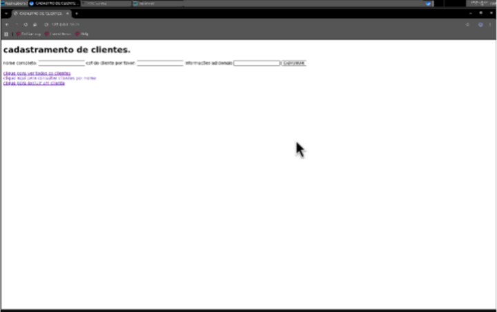
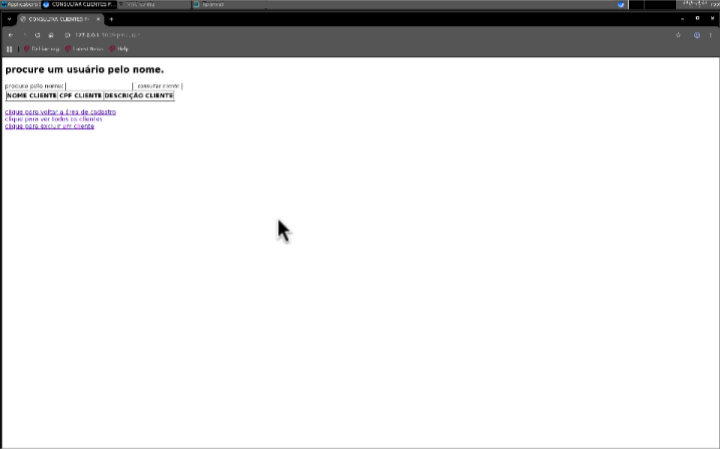
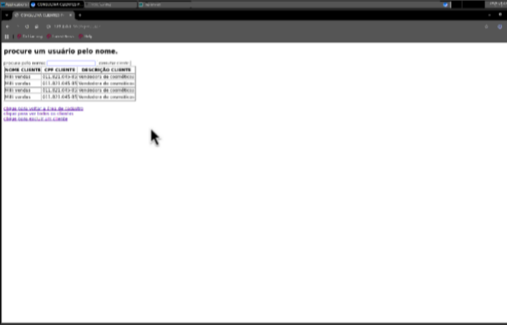
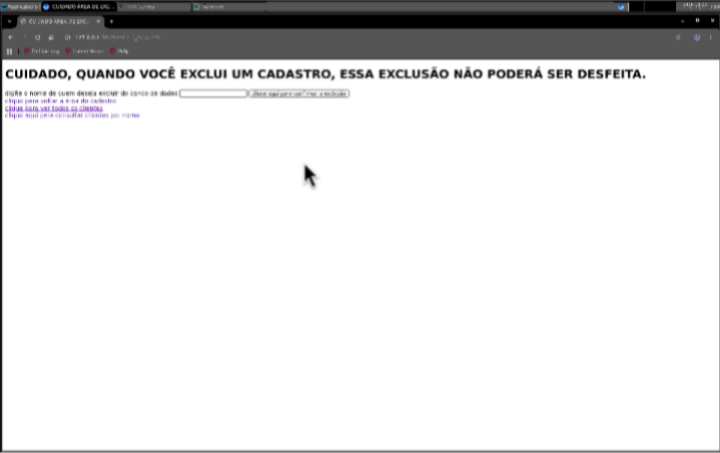

**Aqui temos a tela de cadastro**

**O sistema pede informações brasileiras, caso você for de outro país pode não reconhecer a documentação.**

**Aqui está a tela de procurar usuários cadastrados pelo nome.**

**Aqui está a função de remover um usuário do banco de dados.**

**AVISO ⚠️: criei esse sistema apenas para fim educativo com amigos, você não deve jamais usá-lo para fins comercias.**
